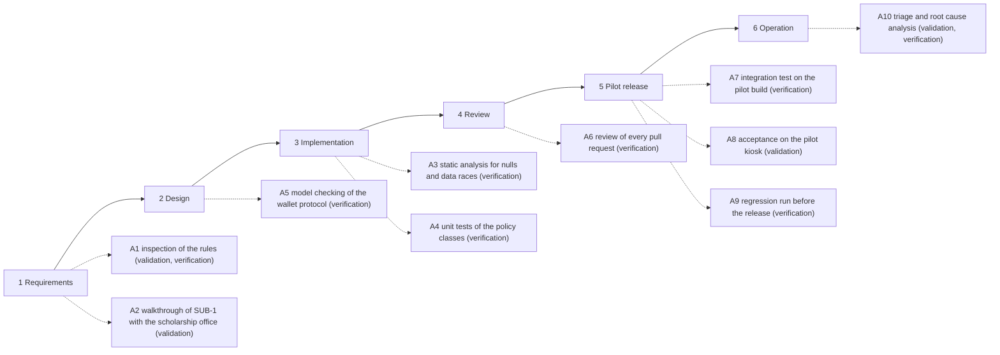

# Lab-01 Task 3: verification and validation in the ITC process

Pair: Choeng Kimlay (Student A), Hai Tongmeng (Student B)

## Activities (one row each)

| Id  | Activity | Phase (earliest) | Verification or validation | Artefact checked | Checked against |
|-----|----------|------------------|----------------------------|------------------|-----------------|
| A1  | Inspection of the numbered rules with a boundary checklist (every "within", "before", "until": inclusive or exclusive?) | 1 Requirements | validation of each rule against the workshop notes; verification of the rules against each other (consistency) | rules SUB-1, REF-1, TOP-1, PUR-1, SET-1 | workshop notes; the other rules |
| A2  | Walkthrough of rule SUB-1 with the scholarship office | 1 Requirements | validation | rule SUB-1 and its worked examples (11:00, 13:59:59, 14:00, Saturday, holiday, no MEAL item, cap 4,000) | what the scholarship office intends: who gets the subsidy, when, for which meal, how much |
| A3  | Static analysis of canteen-core for null dereferences and data races | 3 Implementation | verification | the Java sources of canteen-core on the feature branch, especially the shared state in `Wallet` and `DailyLedger` | the analyser's rules (no possible null dereference, every access to shared mutable state synchronised) and the design decision that wallet operations are atomic |
| A4  | Unit tests of each policy class, derived from the numbered rules | 3 Implementation | verification | `TopUpPolicy`, `SubsidyPolicy`, `RefundPolicy`, `DailyLimitPolicy` and `Wallet` | rules TOP-1, SUB-1, REF-1, PUR-1 and their verified values in the case-study brief |
| A5  | Model checking of the wallet protocol (kiosk and app on one wallet) | 2 Design | verification | the model of the protocol between kiosk, app, API and one wallet (state diagram of the wallet operations) | the stated properties: the balance never goes below 0 or above 1,000,000, no meal is charged twice, no deadlock |
| A6  | Review of every pull request against the rules it implements | 4 Review | verification | the diff and the tests of each pull request (e.g. a change to `TopUpPolicy.fee`) | the numbered rules it implements and the class and state diagrams of canteen-core |
| A7  | Integration test of kiosk, API and core on the pilot build | 5 Pilot release | verification | the pilot build: kiosk software, API and canteen-core deployed together on kiosk 1 | the terminal–API protocol from the design and rules PUR-1 and SET-1 end to end (purchase → receipt → ledger → settlement) |
| A8  | Acceptance test with the canteen manager on the pilot kiosk | 5 Pilot release | validation | the pilot build on kiosk 1, with the real menu | what the canteen manager needs at the counter |
| A9  | Regression run of all tests before every pilot release | 5 Pilot release | verification | the release candidate build of canteen-core and the kiosk | all existing tests, i.e. the numbered rules and every earlier failure turned into a test |
| A10 | Triage and root cause analysis of each failure report | 6 Operation | validation of the report (is it a real unmet need of the holder or the canteen, or a missing or wrong rule?); verification of the cause (reproduce it and compare the observed behaviour with the numbered rule) | the failure reports from the finance office and the production build they were observed on | the needs of the person who reported it; the numbered rules and the design |

## Diagram

## Earliest catch of a misread boundary in SUB-1
A1, the inspection of the numbered rules with the boundary checklist in phase 1 Requirements, catches it earliest: the checklist asks for every "from", "until" and "during" whether it is inclusive or exclusive, so a lunch window read the wrong way is found before any design or code depends on it. It costs about 3 person-hours per iteration: one hour each for both developers to inspect the new and changed rules, plus a half-hour follow-up of both with the scholarship office on any open boundary. If the rule was written correctly and only the developer misread it while coding, A1 cannot see that; the earliest catch is then A4 in phase 3, a unit test on each side of the boundary, which costs about 1 developer-hour per policy class.
